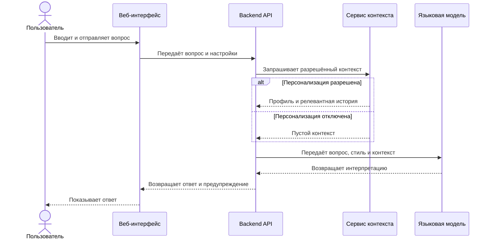
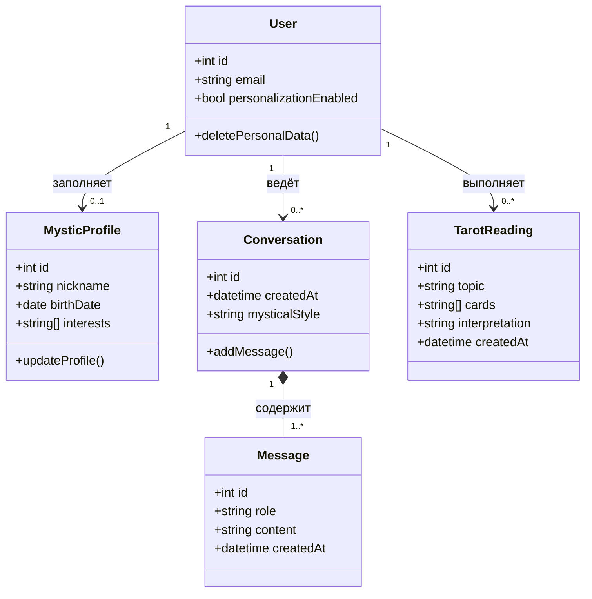

# Диаграммы Astrally

## Диаграмма последовательности

Диаграмма показывает основной сценарий получения ответа в мистическом чате.

## Диаграмма классов

Диаграмма отражает основные сущности первой версии сервиса. Технические классы интеграции с языковой моделью здесь не показаны, чтобы диаграмма оставалась простой и описывала предметную область.

